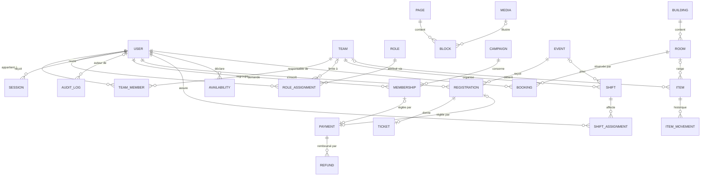

# Modèle de données

Ce document décrit le **schéma global** de la base : toutes les entités demandées par le sujet et leurs relations. Le fichier de référence pour le code est [`apps/api/prisma/schema.prisma`](../../apps/api/prisma/schema.prisma) : il contient pour l'instant les tables du socle, et chaque module y ajoute les siennes.

> Une installation = une association (voir [ADR 0003](../adr/0003-une-installation-par-association.md)). Il n'y a donc pas de colonne `associationId` : l'association, c'est l'installation elle-même (table `Settings`).

## Qui crée quelles tables

| Partie              | Tables                                                                                                                                                 |
| ------------------- | ------------------------------------------------------------------------------------------------------------------------------------------------------ |
| **Socle** (Dev 1)   | `Settings`, `Module`, `Theme`, `User`, `Team`, `TeamMember`, `Role`, `RoleAssignment`, `Session`, `AuditLog`, `Page`, `Block`, `Menu`, `News`, `Media` |
| **Gestion** (Dev 2) | `Membership`, `MembershipStatus`, `Campaign`, `Fee`, `Event`, `Registration`, `Ticket`, `Payment`, `Refund`, `MessageTemplate`, `Message`, `Consent`   |
| **Métier** (Dev 3)  | `Shift`, `ShiftAssignment`, `Availability`, `Building`, `Room`, `Booking`, `Item`, `ItemMovement`, `PushDevice`                                        |

## Schéma des entités

## Règles communes

- Clés primaires : UUID (`String @id @default(uuid())`).
- Chaque table a `createdAt` et, si elle est modifiable, `updatedAt`.
- Montants en **centimes** (`Int`) avec une colonne `currency`.
- Suppression d'une personne : suppression logique (`deletedAt`), puis purge après la durée de conservation configurée (RGPD).
- Toute nouvelle table passe par une **migration Prisma** relue en pull request : `pnpm --filter @gofac/api prisma:migrate`.

## Dictionnaire des champs

Le détail champ par champ est tenu à jour directement dans `schema.prisma` (commentaires `///`), au fur et à mesure que chaque module ajoute ses tables.
